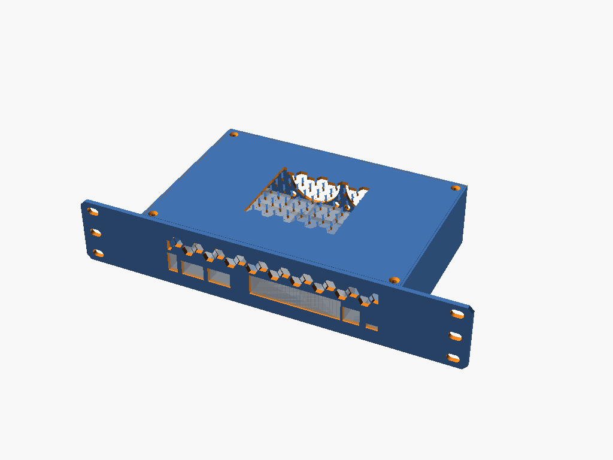

# bpir4-1u-chassis

Enclosed 1U 10-inch (LabRax) rack chassis for the Banana Pi BPI-R4.
Two printed parts: a single-body tray and a flush countersunk lid. The body
is narrowed to hug the board (`body_w()` ≈170mm, not the full rack-clear
width) with four support-free corner posts beside it, each bonded to
**both** walls of its corner as a full-height square column (fillet on the
two internal post↔wall junctions, chamfer on the one exposed free edge —
no angled buttress). Rear exhaust fans are behind an `enable_exhaust` toggle
exposed in the assembly customizer alongside `fan_size`/`fan_count`; the
toggle drives geometry end-to-end via the Customizer (or
`-D enable_exhaust=false`) — active mode is the full-depth box,
**passive mode is a shorter box** (no fan plenum). Both modes cut the
same self-supporting honeycomb hex field over the fan footprint; passive
mode keeps that field as a single band spanning both fans, while active mode
splits it into two per-fan bands and leaves the inter-fan strip between them
solid — that strip sits in the exhaust plume with no fan behind it, so an
open honeycomb there would just recirculate already-warm air and bleed
pressure between the two fans (#78). Active mode also adds the fan mount
screw holes and a solid bearing pad around each one (`fan_pad_dia`), filling
the honeycomb cells each pad overlaps so the pad's material lands on solid
lattice rib rather than hanging bare over open cells, so an M3 head seats on
material rather than on the 1.2mm lattice. The active opening is a honeycomb
grille rather than an open bore because the rear wall is vertical: a bore
through it lies on a horizontal axis and leaves an unsupported near-flat arc
at its crown, and the usual remedy does not fit here — a 45° teardrop of the
36.8mm bore needs 26.02mm of headroom above the bore centre and the lid
ledge leaves only 20mm. The per-fan band split (#78) is a deliberate
open-area tradeoff, not a free win: closing the inter-fan strip measurably
REDUCES open area versus the old bores rather than increasing it — the
active-mode open area over the fan band is now 1565.8 mm²
(`tests/test_bpir4_fan_opening.sh`), against 2239.8 mm² for the two round
bores over that same band — traded away in exchange for closing the
recirculation path and backing every mount screw with solid, self-supporting
material. The rear
exhaust fan mounts on the tray's
interior rear-wall face (screwed in from inside the case, airflow venting out
through the vent); `fan_plenum` auto-derives from the installed fan's depth
(`fan_thickness`, declared per entry file — assembly.scad/parts/tray.scad/
parts/lid.scad/tests/asserts.scad — same as `enable_exhaust` below, defaulting to the `fans`
library's size-keyed `fan_default_thickness()` when unset) plus a clearance margin, so
the fan can never be placed closer to the board than that margin allows. The
chassis ships configured for a 20mm-deep 40mm fan (Noctua NF-A4x20, [A]
vendor datasheet); set `fan_thickness` to your fan's depth, or to a negative
value to fall back to the library default. Intake air runs through
a self-supporting honeycomb hex-vent band above the IO connector cluster
(not side margins), for a straight cross-chassis path over the SFP/connector
tops — no supports needed, since each hex cell's own bridge is only a few mm
(`libraries/honeycomb/honeycomb.scad`, shared with the lid). The lid carries the same
honeycomb pattern over the board's hot zone (`lid_vents`, on by default),
also support-free. Rack ears default to slotted mounting holes
(`ear_hole_type`), with round options available.

**Chamfered corners (#70):** the faceplate blank's front-elevation
silhouette imports `rack10_panel_profile()` from the `rack10` library rather
than hand-rolling a cube, so its four corners get the same 3.0mm 45-degree
chamfer as the other rack10 faceplates (keystone-faceplate, mitx-1u). The
tray's two rear outer vertical corners get their own, smaller 1.2mm 45-degree
chamfer — see `PRINTING.md` for the wall-thickness reasoning and the accepted
lid-lip trade-off at those two corners.

All hardware dimensions are pulled live from the repo libraries (`sbc`,
`rack10`, `fans`).

## Render / build

    make render P=bpir4-1u-chassis
    make run    P=bpir4-1u-chassis   # GUI

## Parameters

The cooling/ear-hole group — `enable_exhaust` (rear fans on/off, customizer
`/* [Cooling] */` group), `fan_size`, `fan_count`, `fan_thickness`,
`ear_hole_type` (`"slot"` default; `"10-32"`/`"m6"`/`"round"` also
available) — is declared per entry file (assembly.scad/parts/tray.scad/
parts/lid.scad/tests/asserts.scad), not in `params.scad`; kept in sync by
`tests/test_bpir4_default_literals_match.sh`; see params.scad's own comment for
why. Everything else lives in `params.scad` directly: `stack_gap`,
`lid_vents` (honeycomb hex vents over the lid's hot-zone band, on by
default), `honeycomb_cell`/`honeycomb_wall` (hex size/spacing shared by the
faceplate and lid vent bands).

## Design Notes

**Heatsink orientation:** The BPI-R4's stock heatsink has fins running
side-to-side, not front-to-back — suboptimal for this chassis's
front-intake/rear-exhaust airflow strategy. No alternative heatsink
orientation is available; this is a known thermal caveat, not a design defect.

**Underside module clearance:** The chassis sizes its internal
floor-to-board gap to the worst-case underside component keep-out: all
optional modules populated simultaneously (2× mini-PCIe + double-sided
M.2-2280). No modules are assumed absent; dimensions derive from the
board's bottom-face data, ensuring flat, stackable underside geometry with
no floor recesses.

**Rear clearance / inserted microSD (#76):** an inserted microSD card
stands 2.3mm proud of the board's rear edge — modelled as the sbc library's
`microsd_1_card` row — and both rear datums derive from it
(`_rear_media_protrusion()` in `params.scad`) rather than a fixed literal, so
a future rear-edge keep-out (the SIM sockets are push-push and still
unmodelled) would widen the datums on its own instead of silently
re-creating a collision. `fan_plenum` (active mode) and `rear_gap` (passive
mode) both add the protrusion on top of their existing clearance —
`fan_board_gap` (1.5mm) and `rear_clearance` (1.6mm) respectively — so
clearance stays strictly greater than the obstruction rather than being
replaced by it. Overall chassis depth is 129.7mm active / 109.8mm passive
(both grew by the same 2.3mm for the microSD protrusion; active grew a
further 10mm when `fan_thickness` went to 20).

**Fan placement (#74):** the two fans are not evenly spaced. Their X centres
are derived from the board's own connector rows (`_fan_x_centres()` in
`params.scad`) and land on the two things that need the air: one over the
centre of the SFP+ cage pair, one over the centre of the RJ45 block. The
earlier layout butted the pair about the chassis centreline, which left
roughly a third of the SFP zone outside the fan footprint on a board whose
SFP+ thermal load is its documented weak point. Deriving the centres rather
than typing them means a future re-caliper of the board moves the fans with
it. A single fan (`fan_count=1`) goes to the SFP zone; three or more fall
back to even spacing. Because the fan position is moulded into the rear wall,
changing it later means reprinting the tray.

The card is **install-once by design**: it is seated once at assembly, and
changing it afterward means removing the lid and unbolting one fan. This is
a deliberate trade-off, not a limitation to be fixed later — there is no
rear access slot, and none is planned.

## Assembly reference

`assembly.scad` has a `show_rack` toggle (`/* [Show] */` group) that renders
a translucent 3U `rack10_placeholder` framing the chassis as the middle U —
a quick sanity check against neighboring rack gear before printing.
