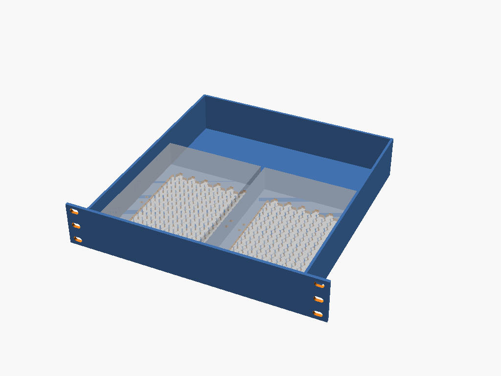

# drive-tray

Parametric 1U `rack10` storage tray: a `cols x rows` grid of bottom-mounted
block drives, honeycomb floor vents, rear `#40` `rack-support` mate. Single-
layer v1 (one Z tier of drives; stacking a second tier is a deferred future
revision). Bottom-mount only, open-top. Consumes `drives` (device data),
`rack10` (rack geometry), `rack-support` (#40 rear mate), `honeycomb` (floor
vents). Units: **mm**.



## Presets

| # | `drive_type` | `cols` x `rows` | `drive_gap` | Drives |
|---|---|---|---|---|
| #44 | `hdd35` | 2 x 1 | 4.0 (default) | 2x 3.5" HDD |
| #45 | `ssd25_9` | 3 x 2 | **2.0** | 6x 2.5"/9.5mm SSD |

`#45` needs `drive_gap` dropped to 2.0: at the file's 4.0 default, the
3-wide `ssd25_9` grid overshoots `standard="labrax"`'s usable width by
0.35mm and the width fit-assert aborts. Both presets are locked (render +
fit-asserts + bottom-hole count) by `tests/test_drive_tray.sh`, against the
default `standard="labrax"` only — the depth fit-assert (and `#45`'s width
margin) are vendor-sensitive, so re-check both before assuming either
preset fits a different rack10 vendor profile.

## Status

**Complete (v1).** Grid layout + drive placement + width/height fit-assert
(Task 1); faceplate/ears/walls/rear `#40` tongue + depth fit-assert (Task
2); honeycomb floor vents (Task 3); locked `#44`/`#45` presets + this doc
(Task 4) — all done.

## Build

```bash
make run P=drive-tray       # interactive
make render P=drive-tray    # regenerate the render above
```

Run `bash tests/test_drive_tray.sh` (from the repo root) for the project's
own test suite.

See [PRINTING.md](PRINTING.md) for print settings.
