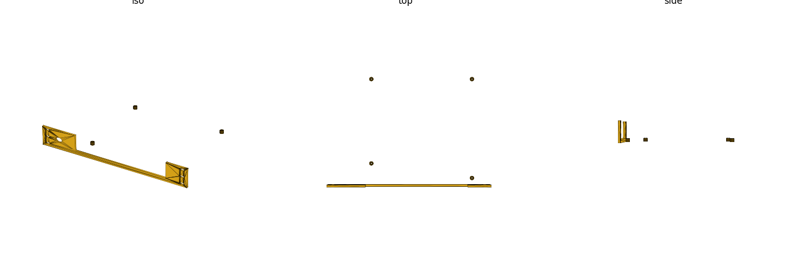

# mitx-1u-chassis

Parametric 1U 10" rack chassis for a mini-ITX board, built "front-IO
appliance" style: the board's rear I/O-shield edge faces the rack **front**
(ports + a power button front-accessible), with a rear `#40` `rack-support`
tongue mate on the rack rear. Consumes `motherboards` (board data), `rack10`
(rack geometry), `rack-support` (rear mate, engagement-depth budget only so
far), `fans`/`honeycomb` (not yet consumed — Tasks 2-3). Units: **mm**.



## Status

**Task 1 of 3 (#42) — scaffold.** This task adds: params + fit-asserts, the
off-center board (standoffs + placeholder), and the front faceplate (rack
ears, IO-shield cutout, power button hole). **Not yet built:** walls, floor,
rear panel, the `rack-support` tongue mate, and the fan/honeycomb vent —
Tasks 2-3.

## Design

- **Off-center board.** The board is shifted `board_offset` mm off the
  panel's centerline (`_board_x() = board_offset - mobo_size("itx")[0]/2`)
  so the panel's low-X margin opens up wide enough to fit a power button
  beside the mini-ITX IO shield, which itself spans almost the full board
  width (158.75 of 170mm) and leaves no usable gap on the board itself.
- **One shared board-frame offset.** `_board_x()` is the single translate
  applied to the standoffs, the `%`-preview placeholder, *and* the IO
  cutout — all three read the board's own local frame (rear-left-corner
  origin per `motherboards.scad`), so they can't drift apart independently.
- **IO cutout direction.** `mobo_io_cutout_stamp()` grows +Y from the
  board's own local Y=0 (its rear/IO edge); the faceplate sits at -Y from
  that same plane (rack10's front-of-panel convention), so the stamp is
  `mirror([0,1,0])`-flipped before being placed in the shared board frame —
  otherwise the cutter grows away from the faceplate and never reaches it.
- **Off-center guard.** Because `board_offset` moves both the IO window and
  the button hole, a fit-assert checks the IO cutout's right edge and both
  edges of the button hole stay within `+-rack10_panel_width/2` (see
  `tests/test_mitx_1u_chassis.sh`'s negative control).
- **Support-free.** The faceplate's ear holes, IO cutout, and button hole
  are all straight-through cuts along the panel's short (thickness) axis —
  no overhangs. See [PRINTING.md](PRINTING.md).

## Customizer parameters

| Param | Group | Default | Notes |
|---|---|---|---|
| `standard` | Rack | `"labrax"` | Rack vendor key (`rack10_known_standards()`) |
| `ear_type` | Rack | `"slot"` | Ear mount hole style passed to `rack10_holes()` |
| `wall` | Print | `2.4` | Side wall thickness, mm (used by the width fit-assert; walls not yet modeled) |
| `floor_th` | Print | `2.0` | Floor thickness eaten out of the 1U height budget |
| `faceplate_th` | Print | `3.0` | Front rack panel thickness, mm |
| `standoff_h` | Print | `6.0` | Board standoff height, mm |
| `heatsink_ceiling` | Print | `25` | Reserved headroom above the board for a heatsink, mm |
| `button_dia` | Front | `12` | Power button hole diameter, mm |
| `board_offset` | Front | `20` | Board X-offset off panel centerline, mm — opens the low-X gap the button sits in |
| `dc_dia`, `fan_size`, `cell`, `hc_wall` | Cooling/Power | `11`, `40`, `8.0`, `1.2` | Reserved for Tasks 2-3 (DC-in jack, fan cutout, honeycomb vent) — not yet consumed |

## Build

```bash
make render P=mitx-1u-chassis    # regenerate the render above
```

See [PRINTING.md](PRINTING.md) for print settings.

## Sourcing

Board size/thickness/standoff/IO-cutout data come from `motherboards`; panel
width, ear hole centers, and 1U device height come from `rack10`; the rear
mate's engagement depth (consumed by `_usable_depth()`'s depth fit-assert
only, ahead of the tongue itself landing in Task 2/3) comes from
`rack-support`. No dimensions are copied — this project calls each lib's
accessors directly.
