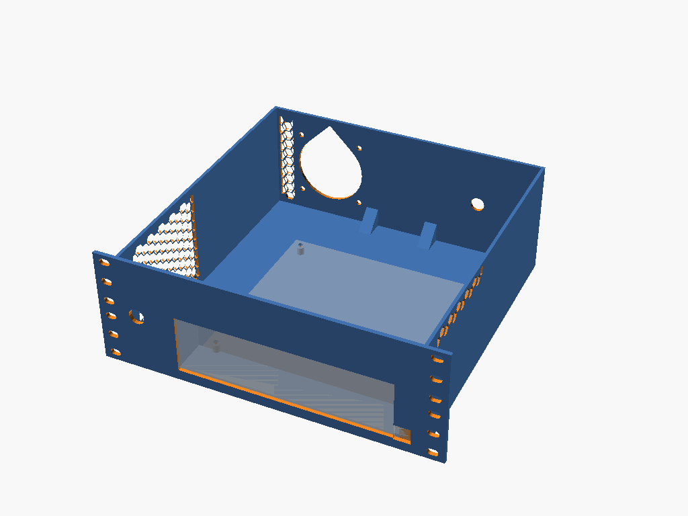

# mitx-2u-chassis

Parametric 2U 10" rack chassis for a mini-ITX board, built "front-IO
appliance" style like its 1U sibling
[mitx-1u-chassis](../mitx-1u-chassis): the board's rear I/O-shield edge
faces the rack **front** (ports + a power button front-accessible), PLUS a
single **low-profile PCIe card aperture + bracket mount** in the front
faceplate (the extra U of height over the 1U sibling is spent on headroom
for a heatsink and a card standing up off the board). Floor + side walls +
rear wall, a rear `#40` `rack-support` tongue mate, a rear exhaust fan
drawing air in through honeycomb intake vents on both side walls, and a
rear DC-in barrel jack. Consumes `motherboards` (board + PCIe-slot data),
`rack10` (rack geometry), `rack-support` (rear tongue mate),
`pcie-bracket` (card bracket size/keep-out + floor mount-hole geometry),
`fans` (fan bore + mount holes), `honeycomb` (self-supporting vent fields).
Units: **mm**.



## Status

**Complete (#43).** A full open-top tray: front faceplate (rack ears, IO
cutout, power button, PCIe slot aperture), off-center board on standoffs,
floor + side walls + rear wall, tongue-flanking corner gussets, the `#40`
rack-support tongue with its own buttress, a rear DC-in barrel jack +
teardropped exhaust fan bore, the PCIe bracket's floor mount hole, and
honeycomb intake/exhaust vents. All geometry verified support-free.

## Design

- **Off-center board.** Same `_board_x()` idiom as mitx-1u-chassis: the
  board sits `board_offset` mm off the panel's centerline
  (`_board_x() = board_offset - mobo_size("itx")[0]/2`), opening a low-X
  margin wide enough for a power button beside the mini-ITX IO shield.
- **One shared board-frame offset.** `_board_x()` is the single translate
  applied to the standoffs, the `%`-preview placeholder, the IO cutout,
  *and* the PCIe slot cutout — all four read the board's own local frame
  (rear-left-corner origin per `motherboards.scad`), so they can't drift
  apart independently. (Verified empirically during implementation: an
  earlier draft translated the IO/PCIe cutter block by `board_offset`
  alone, which put the PCIe slot cutout's world X entirely past the
  panel's own half-width — a silent no-op cut that compiled clean but
  never actually opened. `mobo_pcie_first_xy()` shares the SAME
  component-up local frame as `mobo_io_cutout()`/`mobo_standoff_xy()`, so
  it needs the same `_board_x()` offset, not `board_offset` alone.)
- **IO + PCIe cutout direction.** `mobo_io_cutout_stamp()` and
  `mobo_pcie_cutout()` both grow +Y from the board's own local Y=0 (its
  rear/IO edge); the faceplate sits at -Y from that same plane (rack10's
  front-of-panel convention), so both stamps are `mirror([0,1,0])`-flipped
  before being placed in the shared board frame — otherwise the cutters
  grow away from the faceplate and never reach it.
- **PCIe bracket is the card's own part, not printed here.** This chassis
  provides the **aperture** (a single-slot `mobo_pcie_cutout()` in the
  faceplate) and the **floor mount hole** for the bracket's foot
  (`pcie_bracket_mount_holes()`, a Z-axis cut through the floor at
  `_pcie_slot_cx()`); the bracket itself (`pcie_bracket("low-profile")`)
  is the inserted card's own hardware, shown here only as a `%`-preview.
  The mount hole is cut at world Z mapped so the bracket's local Z=0 (its
  foot's own top face) lands on the floor slab's own top surface — cutting
  `floor_th+standoff_h` (the Task-1 keep-out preview's translate) instead
  would leave the hole floating above the floor and cut nothing; this was
  confirmed empirically via an `intersection()` probe against the floor
  slab in `tests/test_mitx_2u_chassis.sh`.
- **PCIe bracket mount hole vs. the faceplate.** `pcie_bracket_mount_holes()`
  bores straight down through the bracket's foot (flat in the XY plane,
  per `pcie-bracket.scad`'s own header) — not a Y-extruding faceplate
  through-cut like the IO/PCIe-slot stamps — so it is never wrapped in the
  faceplate's own mirror block; wrapping it there is a silent no-op
  (verified empirically: `intersection()` against the faceplate slab is
  empty at every `board_offset`).
- **Off-panel + off-board guards.** Because `board_offset` moves the IO
  window, PCIe slot, and button hole together, fit-asserts check: the IO
  cutout's right edge, the PCIe slot's right edge, and both edges of the
  button hole all stay within `+-rack10_panel_width/2`; the board
  footprint itself stays clear of the side walls' interior faces (ported
  from mitx-1u-chassis's #42 final-review finding); and the PCIe floor
  mount hole stays within the floor slab's own interior span (stricter
  than the panel-width bound, since the panel's ears extend past the
  floor's own footprint) — see `tests/test_mitx_2u_chassis.sh`'s negative
  controls.
- **2U headroom budget.** Two independent ceiling fit-asserts share the
  same `_int_h()` budget above the standoff+board stack:
  `heatsink_ceiling` (a heatsink standing off the board, default 55mm —
  more than double the 1U sibling's 25mm, since 2U's extra rack unit is
  spent mostly here) and `lp_card_h`/`lp_card_len` (the inserted
  low-profile card's own keep-out envelope, extending up off the board and
  rearward from the slot). `lp_card_h`/`lp_card_len` (defaults 64.4mm /
  168mm) are explicit **design placeholders, `//VERIFY`** — no board- or
  bracket-sourced figure for either exists (`pcie-bracket.scad`'s own
  header explicitly carries no card-length/card-envelope data), so these
  are this project's own reasoned keep-out numbers, not `[B]`/`[C]`-tiered
  measurements; tune them to your actual card before printing if it
  differs. A further fit-assert keeps the LP card's length clear of the
  rear gusset/tongue zone.
- **Shell + rear tongue.** Floor, two side walls, and a rear wall (outer
  face flush with the tongue root at `_tongue_y()`) form a plain
  rectangular open-top tray — no cantilever, support-free by construction.
  The `#40` `rack_support_tongue()` is placed at `_tongue_y() =
  rack10_rear_post_y(standard) - rack_support_engagement_depth()` —
  `rack_support_tongue()`'s own documented consumer contract, not the more
  conservative `_usable_depth()` (which additionally reserves
  `faceplate_th` as a separate board-depth margin; the two intentionally
  differ). A buttress strip under the tongue's full engagement reach
  (sized to the tongue's own width, built at
  `rack_support_floor_thickness()`) supports what would otherwise be an
  unsupported horizontal overhang.
- **Tongue-flanking gussets.** `_mitx2_gusset()` braces the rear-wall/floor
  corner immediately beside the tongue on both sides, using the same
  hull-of-6-corner-spheres 45° prism `rack-support.scad`'s own gusset uses.
- **Rear DC-in + exhaust fan, generalized flank offset.** Both cut through
  the rear wall via `rotate([-90,0,0])` (native Z-bore frame → +Y through
  the wall). Unlike mitx-1u-chassis's flat `+-clear_width/4` flank offset
  (which happens to clear its own gusset only at that project's 40mm fan
  default), this project derives the flank center **from the gusset's own
  far edge** plus the wider of the fan/DC-in hole radii plus a fixed
  margin (`_rear_flank_cx()`), so fan/DC-in clear the gusset by
  construction for any `fan_size`/`dc_dia` — not just the values that
  happen to work. (The flat-offset idiom was checked first and found to
  put this project's own 60mm-default fan's near edge *inside* the
  gusset's far edge — a real overlap caught by a fit-assert, which is why
  this project generalizes instead of reusing the 1U idiom verbatim.) The
  fan bore is teardropped (`_mitx2_fan_teardrop()`, 45° roof, apex capped
  at the rear wall's own available headroom) since a plain round hole this
  large is well past the safe plain-hole span; the DC-in hole is left
  plain round since the barrel jack's panel-mount nut needs true
  roundness.
- **Honeycomb vents, asymmetric Z-bands.** Intake fields on both side
  walls (front half, clear of the rear gusset/tongue zone) and an
  exhaust-flanking field on the rear wall (beside the fan's outboard edge,
  clear of its mounting screws and the tongue gusset). The **left** wall
  uses the full ceiling-to-floor band (no nearby hardware); the **right**
  wall's band starts above the LP card's own keep-out envelope top
  (`_card_top_z() = floor_th + standoff_h + mobo_thickness() + lp_card_h`)
  so it can't collide with an inserted card regardless of the card's own
  (unmodeled) width, with a slightly tighter ceiling margin than the left
  wall to buy back some of the headroom that constraint costs. All fields
  are self-supporting hex-cell cuts via `honeycomb_vent()`, oriented so
  the bridge-sensitive "height" axis always lands vertical.
- **Support-free.** Every cut and every added solid (faceplate holes, IO
  cutout, PCIe slot aperture, button hole, walls, gussets, tongue+buttress,
  fan teardrop, PCIe floor mount hole, honeycomb vents) is either a
  straight-through cut along a print-vertical axis or a monotonically-
  narrowing 45° prism — no unsupported overhangs anywhere. See
  [PRINTING.md](PRINTING.md).

## Customizer parameters

| Param | Group | Default | Notes |
|---|---|---|---|
| `standard` | Rack | `"labrax"` | Rack vendor key (`rack10_known_standards()`) |
| `ear_type` | Rack | `"slot"` | Ear mount hole style passed to `rack10_holes()` |
| `device_u` | Rack | `2` | Rack unit height |
| `wall` | Print | `2.4` | Side/rear wall thickness, mm — sizes the width fit-assert, the walls themselves, and the gusset/vent clearances |
| `floor_th` | Print | `2.0` | Floor thickness eaten out of the 2U height budget |
| `faceplate_th` | Print | `3.0` | Front rack panel thickness, mm |
| `standoff_h` | Print | `6.0` | Board standoff height, mm |
| `heatsink_ceiling` | Print | `55` | Reserved headroom above the board for a heatsink, mm — checked against `_int_h()` by a fit-assert |
| `button_dia` | Front | `12` | Power button hole diameter, mm |
| `board_offset` | Front | `20` | Board X-offset off panel centerline, mm — opens the low-X gap the button sits in |
| `pcie_screw` | Front | `"6-32"` | Bracket mount-screw thread family (`pcie_known_screws()`) — sizes the PCIe floor mount hole |
| `dc_dia` | Cooling/Power | `11` | Rear DC-in barrel jack hole diameter, mm — plain round cut through the rear wall |
| `fan_size` | Cooling/Power | `60` | Rear exhaust fan frame size, mm — must be a size `fan_known_sizes()` recognizes; drives the teardropped bore + `fan_holes()` mount pattern |
| `cell` | Cooling/Power | `8.0` | Honeycomb cell size, mm — shared by all vent fields |
| `hc_wall` | Cooling/Power | `1.2` | Honeycomb wall thickness, mm — shared by all vent fields |
| `lp_card_h`, `lp_card_len` | PCIe keep-out | `64.4`, `168` | Reserved envelope for the inserted low-profile card (height off the board, length rearward from the slot) — design placeholders, `//VERIFY`, no board/bracket-sourced figure exists for either; tune to your actual card |

## Build

```bash
make render-dind P=mitx-2u-chassis   # regenerate the render above (headless, no local GL needed)
```

See [PRINTING.md](PRINTING.md) for print settings.

## Sourcing

Board size/thickness/standoff/IO-cutout/PCIe-slot data come from
`motherboards`; panel width, ear hole centers, and 2U device height come
from `rack10`; the rear tongue's placement and engagement depth come from
`rack-support` (`rack_support_tongue()`, `rack_support_engagement_depth()`,
`rack_support_rail_size()`, `rack_support_floor_thickness()`); the PCIe
bracket's own size/keep-out envelope and floor mount-hole geometry come
from `pcie-bracket`; fan mount spacing/bore sizing comes from `fans`; the
vent cutter geometry comes from `honeycomb`. No dimensions are copied —
this project calls each lib's accessors directly. `lp_card_h`/
`lp_card_len` are the one deliberate exception: this project's own
`//VERIFY` design placeholders, not sourced from any library.
