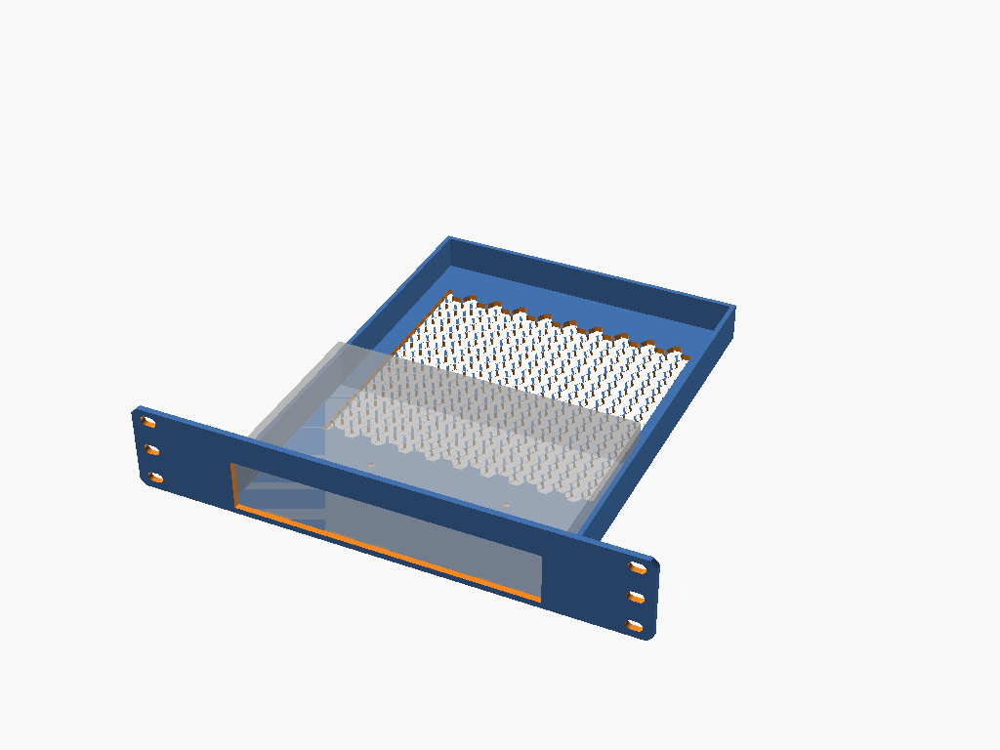

# rack10-device-tray

TODO: describe the item.



## Build

```bash
make run P=rack10-device-tray       # interactive
make render P=rack10-device-tray    # regenerate the render above
```

See [PRINTING.md](PRINTING.md) for print settings.
